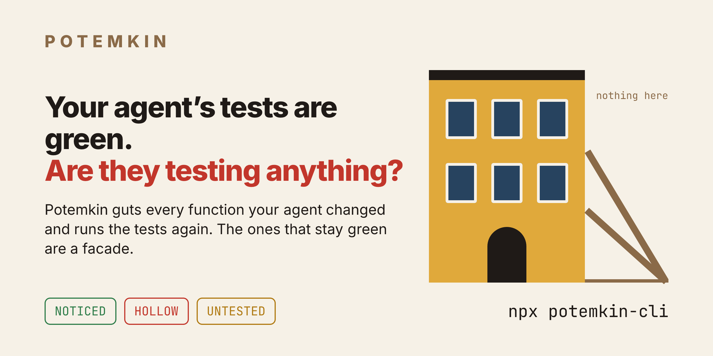
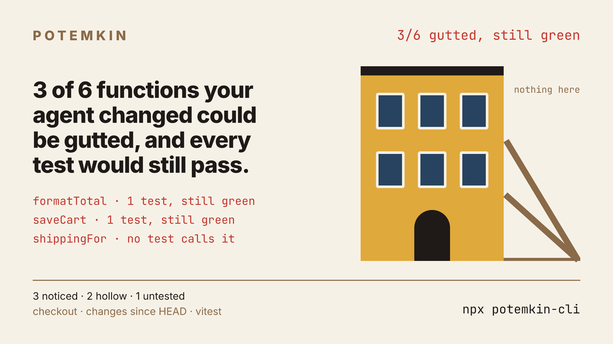
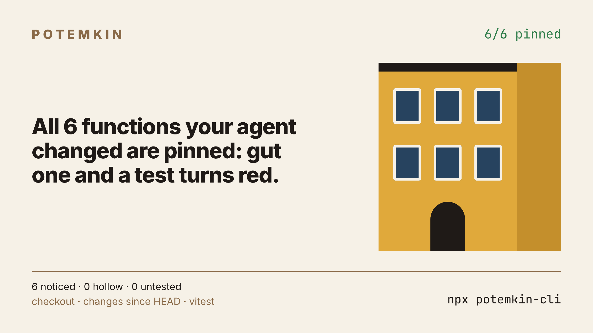

<p align="center">
  
</p>

<p align="center">
  <a href="https://www.npmjs.com/package/potemkin-cli"></a>
  <a href="https://github.com/rosehgal/potemkin/actions/workflows/ci.yml"></a>
  
  
  <a href="LICENSE"></a>
</p>

<h3 align="center">Your coding agent's tests are green.<br>Potemkin guts the code they test and runs them again.</h3>

```bash
npx potemkin-cli
```

It finds every function your diff changed, makes each one return nothing, and reruns the tests that load it. A test that still passes was never checking that function. It was a facade.

<p align="center">
  
</p>

<sub>Demo runs on the sample repo from <a href="scripts/demo.ts"><code>scripts/demo.ts</code></a>.</sub>

## Four verdicts

| | Verdict | Meaning |
|---|---|---|
| 🟢 | **NOTICED** | a test failed when the function was gutted |
| 🔴 | **HOLLOW** | tests run it (they fail when it throws, or it leaves a mark when called), yet all of them pass when it returns nothing |
| 🟡 | **UNTESTED** | no test that loads its file calls it |
| ⚪ | **UNVERIFIABLE** | Potemkin could not get an honest answer, and says why |

The headline counts HOLLOW plus UNTESTED: functions that could be deleted outright without a single test turning red.

> **Your source files are never modified.** Potemkin copies the repo to a temp directory, mutates the copy, and deletes it when done, including on Ctrl-C. No account, no API key, no network, no telemetry.

## How it works

```
git diff ──▶ functions whose structure changed (comments, formatting, moves and renames do not count)
                                   │
            a copy of the repo in $TMPDIR (dependencies linked in, caches kept inside)
                                   │
   related tests (vitest related, jest --findRelatedTests, pytest by import), run once as a baseline
                                   │
   EMPTY mutant: body → `return undefined` ── a test turns red? ──▶ NOTICED
                                   │ all green
   ask the whole suite: which tests load this file at all?  (a throw at the top of the file)
                                   │
   EMPTY again, against every test that loads it ── red? ──▶ NOTICED
                                   │ all green
   THROW mutant: body → `throw` ── red twice, or called? ──▶ HOLLOW
                                   │ never called
                                   ▼
                                UNTESTED
```

Potemkin is built to be wrong in the safe direction. It would rather say NOTICED or UNVERIFIABLE than accuse a test on a maybe:

- A crash, a timeout or output it cannot read counts as "noticed".
- A test that already fails before any change (say, no database running) cannot notice anything, so the functions it might check become UNVERIFIABLE, with the reason.
- A test that fails only once when the function throws is not counted as a caller.
- If the tests do not load the sandbox copy at all (a workspace link or an editable install pointing at the original checkout), Potemkin detects it and refuses to judge.

It is fast because most functions stop at the first step. The sample repo takes 4 seconds.

## Share card

```bash
npx potemkin-cli --share
```

Renders `potemkin-card.png` where you run it (satori + resvg, all local), sized for X, LinkedIn and Slack.

<table>
  <tr>
    <td width="50%"></td>
    <td width="50%"></td>
  </tr>
  <tr>
    <td align="center"><sub>Facade</sub></td>
    <td align="center"><sub>Load-bearing</sub></td>
  </tr>
</table>

The card names functions and the repo folder, so read it before you post it. Functions Potemkin could not check are counted on the card, never hidden.

## Real numbers

The author's own Next.js app, last commit (26 files, +2352 lines, written by an agent), on a laptop with no database running:

```
Potemkin · 38 functions changed since HEAD~1 · vitest · 229 tests · 63 runs in 1m 52s

  NOTICED        23  a test failed with it gutted
  HOLLOW          0  tests run it, yet all pass with it gutted
  UNTESTED        3  no test that loads its file calls it
  UNVERIFIABLE   12  Potemkin could not tell

3 of 26 functions could be gutted, and every test would still pass.
12 more functions could not be checked (below).
39 tests already fail on the current code and were left out.
```

The three untested functions are a React table no test renders. The twelve it would not judge sit behind integration tests that need Postgres, which was not running, so Potemkin said so instead of guessing.

## Guard: send the agent back before you read its diff

`potemkin guard` is a Claude Code Stop hook. When the agent finishes a turn, it checks the uncommitted work (at most 10 functions, inside the hook's time limit). If any function is HOLLOW, it blocks the stop once and tells the agent which tests run the code without checking it, so it strengthens them or says plainly that they check nothing.

```bash
npx potemkin-cli install     # adds the hook to ~/.claude/settings.json
npx potemkin-cli uninstall   # removes it
```

Both are idempotent, keep your other hooks and settings, and write through a symlinked `settings.json`. The hook checks each diff once, stands down when Claude Code marks the stop as a retry (`stop_hook_active`), and lets the stop through on any error.

## In CI

```yaml
- uses: actions/checkout@v4
  with:
    fetch-depth: 0   # Potemkin needs the branch point
- run: npx potemkin-cli --base origin/main --strict
```

`--base` checks only what changed since the branch left `main`; `--strict` exits 1 when any function is HOLLOW or UNTESTED, or when nothing could be judged. `--json` gives every verdict with its reason and tests.

## Options

```
--base REF       compare with REF; with a branch, only what changed since you left it
                 (default: your uncommitted work, or the last commit if there is none)
--max N          check at most N functions, spread across files (default 40; guard 10)
--timeout S      seconds per test run (default 120)
--share          also render the share card (implied by --out)
--out FILE       card path (default ./potemkin-card.png)
--json           every function with its verdict, reason and tests
--strict         exit 1 if any function is HOLLOW or UNTESTED
-v, --version    print the version
```

Supports **vitest**, **jest** and **pytest**, on JavaScript, TypeScript (including JSX/TSX) and Python. Exit codes: 0 on success, 1 with `--strict` when something is hollow or on an error, 2 on a bad flag. Set `DEBUG=1` for stack traces.

## Is this mutation testing?

Yes, the most extreme kind. Classic mutation testing (flip `<` to `<=`, `+` to `-`) asks whether your tests catch small bugs, and tries thousands of mutants to find out. Potemkin asks a blunter question, once per changed function: would any test notice if this function did nothing at all? That is how agent-written tests fail most often: they call the code and assert nothing about it.

| | Potemkin | [Stryker](https://github.com/stryker-mutator/stryker-js) | [mutmut](https://github.com/boxed/mutmut) | [cargo-mutants](https://github.com/sourcefrog/cargo-mutants) |
|---|---|---|---|---|
| Scope | functions your diff changed | whole project, or incremental | whole project | whole crate, or `--in-diff` |
| Mutants per function | 2 (return nothing, throw) | many operators | many operators | a few return-value replacements |
| Agent hook | Claude Code Stop hook | no | no | no |
| Languages | JS, TS, Python | JS, TS, C#, Scala | Python | Rust |

For full mutation scores, use those tools. Potemkin is the quick check you run before you trust a green diff. Its "return nothing" mutant is the same idea as Descartes' extreme mutation for Java.

## FAQ

**Why a sandbox?** Mutating your files in place would be simpler, but a crash or Ctrl-C at the wrong moment would leave a gutted function in your working tree, and a parallel agent might read it. Potemkin copies everything git can see, links installed dependencies in, copies `.env` files, resets whatever a test run leaves behind, and removes the copy when it exits.

**What does UNVERIFIABLE mean?** Potemkin could not get an honest answer. The reason is printed: related tests that already fail, no supported runner, a test suite that crashes or times out, a symlinked source file, or tests that load the original checkout instead of the sandbox copy.

**Why UNVERIFIABLE when I have an integration test for it?** If that test fails before any change (it needs a database, say), it cannot notice anything, so Potemkin will not accuse the function. Start your services and run it again.

**My project has a second test config (`vitest.integration.config.ts`).** Potemkin runs the default one and lists the others under "Not run", so you know what was left out.

**Does it work with Codex, Cursor, Gemini CLI?** The check works on any git diff, whoever wrote it. The guard hook is Claude Code only for now.

## Also

[Pinocchio](https://github.com/rosehgal/pinocchio) checks your agent's "all tests pass" against the commands it actually ran. Potemkin checks whether those tests test anything.

## License

MIT
